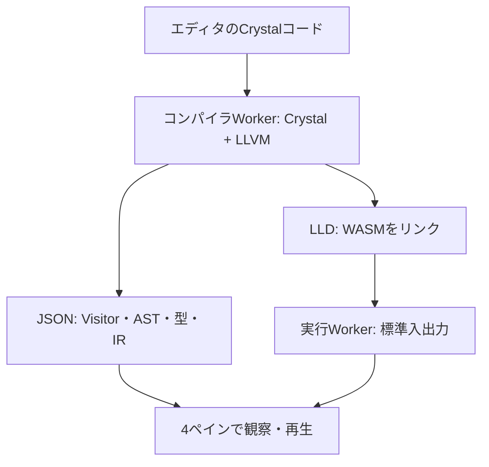

# Crystal Observatory

**任意のCrystalコードを、ブラウザ内で解析・LLVM生成・WASMへのリンク・実行できるコンパイラ観察アプリです。**

単にASTを描くのではなく、Visitorの訪問と戻り、型の変更、型の依存関係、マクロ等の展開、呼び出すメソッドの具体化、LLVM IR生成位置を記録して再生します。教材用にコンパイラをJavaScriptで模倣したものではありません。

ブラウザ版は **Crystal 1.22.0 + WASI/例外処理パッチ、LLVM 20.1.8、LLD** を使用します。入力内容を実際にコンパイルして得たVisitor・型推論・変換の履歴を表示します。ローカルのコンパイラサービスや外部APIは使いません。移植基盤は [live-codes/browser-crystal](https://github.com/live-codes/browser-crystal) と [live-codes/llvm-wasm](https://github.com/live-codes/llvm-wasm) です。

## すぐ試す：ブラウザ版

ZIPを展開し、`crystal-observatory`ディレクトリで次を実行します。最初にNode 24とnpmでWASIホストのJavaScriptを準備します。Rubyは静的ファイルを配信するだけです。Crystal・LLVMのインストールは不要です。

```sh
npm ci --ignore-scripts
npm run web:deps
ruby -run -e httpd web -p 8000 --bind-address=127.0.0.1
```

WEBrickがない場合は`gem install webrick`で追加します。Python 3でも`python3 scripts/serve.py`で同じ画面を開けます。

ブラウザで <http://127.0.0.1:8000/> を開きます。`file://`でHTMLを直接開くと、Workerやサンプルの読み込みが制限されるため、HTTPから開いてください。

1. エディタにコードを書き、**実行**を押します。初回はコンパイラ・LLVM・LLDなどを読み込みます。
2. **実行**タブで標準出力と終了コードを確認します。`gets`用の標準入力、`ARGV`用のJSON配列も指定できます。
3. **AST**・**型の依存**・**LLVM IR**で同じコンパイルの結果を観察します。
4. **次の型**・**次の変換**で、実際のVisitorの処理を追います。
5. **LLVM**は実行せず解析・リンクまで、**再実行**は生成済みWASMを新しいWorkerで実行します。

**入力例**はコードをエディタへ入れるだけです。必ずそのコードを新しくコンパイルします。過去の記録を見たいときだけ**収録記録**を押します。**構文**は従来の軽量なLexer・Parser専用エンジンです。

ソースを外部へ送信しません。初回のコンパイラ資材は約26 MBの圧縮データで、同じ画面での再解析ではコンパイル済みモジュールを再利用します。新しいChrome等、標準WebAssembly例外処理に対応するブラウザが必要です。NodeでのテストにはNode 24と`--experimental-wasm-exnref`を使用します。

入力は256 KiB、トレースは40,000イベント・8,000ノード、コンパイルは120秒、プログラム実行は10秒・256 MiB・出力256 KiBが上限です。停止ボタンでWorkerを破棄できます。上限に達した記録は省略の表示が出ます。

実行先はWASIです。スレッド、OSプロセス、ソケット、ホストのファイルへのアクセスやネイティブCライブラリを必要とするshardには対応しません。WASMランタイムはGCなしのため、長時間のプログラムには向きません。通常の構文、型、マクロ、コレクション、正規表現、標準入出力、例外処理を対象とします。

## Web画面の配置

Crystal公式サイトを参考に、黒いヘッダー、チャコール色のコード表示、白い観察領域を組み合わせています。型の変化には淡い紫を使い、通常の選択と区別します。

- 左から **ソース／観察（AST・型依存・Tokens・LLVM IR・実行）／詳細／履歴** の縦4ペインです。履歴を右端へ移し、各ペインを画面の残りの高さまで広げています。
- 上部は28pxの操作行と20pxの工程・状態行の計48pxです。省略された状態・エラーは、状態の文字をクリックすると全文を開けます。
- 3本の縦の境界をドラッグすると、隣り合う2ペインの幅を調整できます。Tabで境界を選び、左右キーでも調整できます（Shiftで大きく移動）。Homeまたはダブルクリックで、その2ペインの幅比を初期値に戻します。
- 観察ペイン右上の拡大ボタンで最大化し、Escで戻せます。履歴右上の **›** で履歴を折りたたみ、**‹** で復帰します。
- 幅はブラウザに保存します。上部の **↺**（配置をリセット）で初期配置へ戻せます。旧版の「履歴の高さ」の設定は引き継ぎません。
- 右上の **JA / EN** で操作、説明、ヘルプ、状態表示を切り替えます。コード・選択位置・フィルタ・実行結果を保持し、表示言語は次回にも記憶します。入力コードやコンパイラ診断、内部の識別子は翻訳しません。
- 幅の狭い画面でも4列を維持し、ワークスペース内を横スクロールできます。上部操作も必要に応じて横スクロールでき、言語切替は常に表示します。

## 8つの実験

| サンプル | 観察すること |
|---|---|
| 01 specialization | 引数型に応じたDefの具体化、戻り値の型 |
| 02 union_and_narrowing | 分岐の合流によるUnionと`is_a?`による絞り込み |
| 03 macro_expansion | Macroと、展開によって生まれたASTの対応 |
| 04 normalization | `+=`、`unless`、`until`の正規化 |
| 05 overloads | Int32版とFloat64版の呼び出し先の選択 |
| 06 cleanup | 呼ばれないメソッド、定数条件、CleanupTransformer |
| 07 struct | 型宣言、initialize、生成されたnew、メソッド呼び出し |
| 08 type_error | エラーに至るまでのイベントと診断 |

`Def`の宣言式に付く`Nil`と、そのメソッドを呼んだときの戻り値の型は区別してください。前者はTopLevelVisitorの処理、後者は呼び出し先を具体化する段階の情報です。

## 可視化の仕組み



| 観測点 | 取得する情報 |
|---|---|
| `ASTNode#accept` | 実際のVisitor名、訪問・戻り、ネスト、ノードID |
| `ASTNode#transform` | Transformer名、変換前後のコード、置換先ID |
| `ASTNode#set_type` | 型が変わる前と後 |
| `add_observer` / `remove_observer` | 型の依存関係の追加・解除 |
| `Call#recalculate` | 呼び出し先の型付きDefが変わったときの対応 |
| `expanded=` | 展開元と展開後のノード、コード、スナップショット |
| `ProgressTracker#stage` | コンパイラ本来の各工程の開始・終了 |
| `CodeGenVisitor`訪問終了 | LLVM Builderの関数・基本ブロック・末尾の命令 |

観測処理は別ファイルのクラス再オープンと`previous_def`で追加しています。コンパイラ本体のVisitorや意味解析のアルゴリズムを置き換えません。シリアライズのための観察用巡回中はフックを停止し、自分で発生させた訪問が実コンパイラのイベントに混ざらないようにしています。

ASTは一度だけ表示すると、マクロ展開やメソッド具体化がCleanupによって消える場合があります。そのため、工程終了に加えて展開・呼び出し解決の時点でも記録します。AST図はこれらの時点の記録です。イベントごとの完全な木の巻き戻しではありません。

型の依存グラフと訪問スタックは、選択したイベントまでの履歴から復元します。型の矢印は**依存先 → その型を参照するノード**です。これにより、単純な一回の深さ優先探索では説明できない型の再計算を観察できます。

## GitHub Pages

`web/`には必要なWASMと圧縮済みの実測トレースを同梱しています。PagesワークフローがnpmからWASIホストを準備します。公開後にNodeやサーバー側コンパイラは不要です。

1. このプロジェクトを自分のGitHubリポジトリへ配置します。
2. Settings → Pages → Sourceを **GitHub Actions** にします。
3. `main`へのpush、または **GitHub Pages** ワークフローの手動実行で公開します。

この作成作業では、GitHubへのpushや公開は行っていません。

プロジェクト配下のURLにも対応できるよう、WASM、Worker、サンプルのURLはすべて相対指定です。SharedArrayBufferを使用しないため、COOP/COEPの独自ヘッダーは不要です。コンパイルごとに新しいWASMインスタンスとメモリ内ファイルシステムを作り、プログラムは別Workerで実行します。

軽量な構文解析WASMだけを作り直す場合：

```sh
# wasm-ldをPATHに置く。Ubuntuの例
export PATH="/usr/lib/llvm-18/bin:$PATH"
make wasm
```

`kojix2/wasm-libs` v0.0.5のsysrootを取得し、SHA256を確認して使用します。対象ソースのWASI EventLoopに合わせて`-Dwithout_mt`を指定します。

全工程のブラウザ用コンパイラを作り直す場合は、Crystal 1.22.0、LLVM 20開発ライブラリ・`opt`・`llc`、C++コンパイラ、Node 24（WASMの検証用）を用意します。Linux x86_64で検証しています。

```sh
LLVM_CONFIG=llvm-config-20 make browser
```

ビルド時だけwasi-sdk 33と`@live-codes/llvm-wasm` 0.1.0を取得し、SHA256を確認します。上流のソースパッチは固定コミットから`.cache/sources/browser-port/apply-patches.py`へ取得し、固定したCrystal 1.22.0のコピーへ適用します。

実測サンプルを作り直す場合（Node 24で、ブラウザと同じWASMコンパイラ・LLVM・LLDを使用）：

```sh
make samples
```

## テストと範囲

```sh
make web-deps
make samples           # examples/*.crをWASMでコンパイルし、収録記録を更新
make test              # Pythonの依存取得テストとNodeのWASM・UIモデルテスト
npm run lint
npm run format:check
```

テストは、任意のコードから意味解析・LLVM・リンク・実行までの処理、例外、標準入力、引数、正規表現、診断後の再解析を確認します。記録の参照整合性、Visitorのスタック、巻き戻し、型依存、マクロ展開、オーバーロード、軽量構文WASM、Workerの中止・競合、JA/EN辞書と4ペインの幅計算も対象です。

詳しい観測範囲、制約、WASM版の構成は [ARCHITECTURE_JA.md](docs/ARCHITECTURE_JA.md)、検証結果は [VALIDATION_JA.md](docs/VALIDATION_JA.md) を参照してください。

## 出典とライセンス

アプリ独自コードはMIT。Crystal本体や依存ライブラリは各自のライセンスに従います。[THIRD_PARTY.md](THIRD_PARTY.md) を参照してください。

構想とWASM構文解析の先行例として、ユーザー提供の [kojix2/astv.cr](https://github.com/kojix2/astv.cr) を参照しました。ユーザーが引用したフォーラムの「コンパイラをライブラリとして読み込む」という方法を、実際の解析エンジンに発展させています。

保守時の責任分担・残した回避策・検証手順は [保守ガイド](docs/MAINTENANCE_JA.md) を参照してください。

Gitへの移行と依存の更新方法は [DEPENDENCIES_JA.md](docs/DEPENDENCIES_JA.md) を参照してください。
