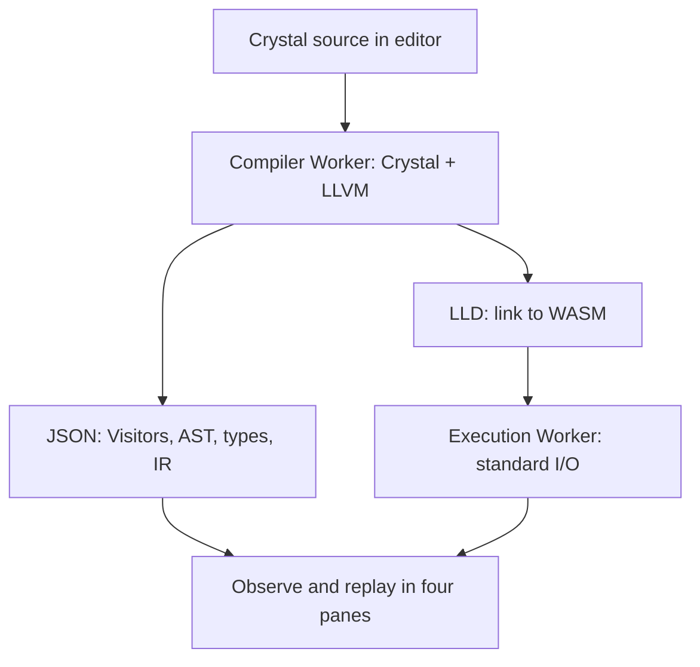

# Crystal Observatory

**A browser-based tool for compiling, inspecting, linking, and running Crystal code.**

Rather than merely drawing an AST, Crystal Observatory records and replays Visitor entry and exit, type changes, type dependencies, macro expansions, method specialization, and LLVM IR insertion points. It does not imitate the compiler in JavaScript for teaching purposes.

The browser version uses **Crystal 1.22.0 with WASI/exception-handling patches, LLVM 20.1.8, and LLD**. It displays observations from compiling the submitted source with the real compiler. Source is not sent to a local compiler service or an external API. The port is based on [live-codes/browser-crystal](https://github.com/live-codes/browser-crystal) and [live-codes/llvm-wasm](https://github.com/live-codes/llvm-wasm).

## Try the browser app

Unzip the project and run these commands from the `crystal-observatory` directory. Node 24 and npm prepare the JavaScript WASI host. Ruby only serves static files; installing Crystal or LLVM is not required.

```sh
npm ci --ignore-scripts
npm run web:deps
ruby -run -e httpd web -p 8000 --bind-address=127.0.0.1
```

If WEBrick is unavailable, install it with `gem install webrick`. Python 3 can serve the same app with `python3 scripts/serve.py`.

Open <http://127.0.0.1:8000/> in a browser. Use HTTP rather than opening the HTML through `file://`, which restricts Workers and sample loading.

1. Enter code in the editor and select **Compile & run**. The first run loads the compiler, LLVM, LLD, and related assets.
2. Inspect standard output and the exit code in **Output**. You can provide stdin for `gets` and a JSON array of arguments for `ARGV`.
3. Inspect the same compilation in **AST**, **Types**, and **LLVM IR**.
4. Use **Next type** and **Next rewrite** to follow actual Visitor work.
5. **Compile → IR** analyzes and links without running the program. **Run again** executes the generated WASM in a fresh Worker.

Selecting an **Example** puts its source in the editor; that source is compiled anew. Select **Example trace** only to inspect a bundled recording. **Parse only** uses the separate lightweight Lexer/Parser engine.

Source stays in your browser. The compressed compiler assets total about 26 MB on first load. The app reuses the compiled WebAssembly module for later analyses in the same page. Use a recent browser that supports standardized WebAssembly exception handling. Node tests use Node 24 with `--experimental-wasm-exnref`.

Limits are 256 KiB of input, 40,000 trace events, 8,000 AST nodes, and 120 seconds per compilation. Program execution is limited to 10 seconds, 256 MiB of memory, and 256 KiB of output. Stop terminates the Worker. Traces indicate when their contents have been truncated.

Programs target WASI. Threads, OS processes, sockets, host filesystem access, and native C libraries required by shards are unavailable. The WASM runtime has no GC and is unsuitable for long-running programs. The app is intended for ordinary Crystal syntax, types, macros, collections, regular expressions, standard I/O, and exception handling.

## Web interface layout

The interface combines a dark header and code editor with a white observation area, inspired by the official Crystal website. Type changes use a light purple highlight to distinguish them from selection.

- Four vertical panes appear from left to right: **Source / observation (AST, Types, Tokens, LLVM IR, Output) / details / History**. History is on the far right; each pane fills the remaining viewport height.
- The header is 48 px high: a 28 px command row and a 20 px stage/status row. Click a truncated status or error to open its full text.
- Drag any of the three vertical dividers to resize adjacent panes. Focus a divider with Tab and use the arrow keys to resize it; Shift moves it farther. Home or double-click resets the ratio of the two adjacent panes.
- Maximize the observation pane with its upper-right button and press Esc to restore the layout. Use **›** and **‹** in History to collapse and restore that pane.
- Pane widths are saved by the browser. Use **↺** to restore the initial layout. The previous version’s saved History height is not carried over.
- **JA / EN** in the upper-right switches the UI, descriptions, help, and status text. Source, selection, filters, and execution results are preserved, and the language choice is remembered. Source, compiler diagnostics, and internal identifiers are not translated.
- All four columns remain available on narrow screens; scroll horizontally within the workspace. The top command row can also scroll horizontally while keeping the language selector visible.

## Nine experiments

| Sample | What to observe |
|---|---|
| 01_specialization | Method specialization by argument type and return types |
| 02_union_and_narrowing | A union at a branch merge and narrowing with `is_a?` |
| 03_macro_expansion | A macro and the AST produced by its expansion |
| 04_normalization | Normalization of `+=`, `unless`, and `until` |
| 05_overloads | Choosing between `Int32` and `Float64` overloads |
| 06_cleanup | Unused methods, constant conditions, and `CleanupTransformer` |
| 07_struct | Type declarations, `initialize`, generated `new`, and method calls |
| 08_type_error | Events and diagnostics leading to a type error |
| 09_declarations | Type creation/reopening, inheritance, include/extend, method registration, and macro generation |

Do not confuse the `Nil` type on a `Def` declaration expression with the return type of calling that method. The former reflects TopLevelVisitor work; the latter is known when resolving a call target.

### Follow declarations and the type hierarchy

Open the recording for example 09 and use the **Declarations** tab and **Next declaration**. The type list shows observed declaration sites, relationships, and methods, with links to source, AST, and history. `#` denotes an instance method; `.` denotes a class method. Selecting a type or node does not change the playback position. If a macro-generated AST node appears only in a later snapshot, its AST link switches snapshots and disables follow mode to show it.

The view shows observed state up to the selected event; rewinding removes later registrations. It is not a complete symbol table. It excludes complete standard-library contents, generated `new` methods, constants, aliases, enums, FFI declarations, and other declaration kinds. Older and parse-only traces report declarations as unobserved, distinct from a new trace before its first declaration.

## How observations are produced



| Observation point | Recorded information |
|---|---|
| `ASTNode#accept` | Actual Visitor name, entry/exit, nesting, and node ID |
| `ASTNode#transform` | Transformer, before/after code, and replacement node ID |
| `ASTNode#set_type` | Type before and after the change |
| `add_observer` / `remove_observer` | Added or removed type dependencies |
| `Call#recalculate` | Changes to the call’s typed `Def` targets |
| `expanded=` | Expansion source and result nodes, code, and snapshots |
| `ProgressTracker#stage` | Start and end of compiler stages |
| End of `CodeGenVisitor` visits | LLVM Builder function, basic block, and trailing instructions |
| Successful TopLevelVisitor registration points | Type creation/reopening, inheritance, include/extend, and explicit method registration |

Most observation hooks are added through class reopening and `previous_def` in separate files. Declaration instrumentation is inserted at successful mutation points in the pinned TopLevelVisitor source during the build. It does not edit the upstream checkout; it applies to the generated build tree and fails if the expected source fragments do not match. This does not replace the compiler’s Visitors or semantic-analysis algorithms. Observation hooks are muted while serializing AST snapshots so that our own traversal does not appear as compiler work.

A single AST snapshot can miss macro expansions or specialized methods later removed by Cleanup. Therefore, snapshots are also captured at stage boundaries, expansions, and call resolution. They are point-in-time ASTs, not a fully reversible AST history for every event.

The type dependency graph and Visitor stack are replayed up to the selected event. Arrows point from the **dependency to the node that observes its type**, making type recalculation visible beyond a simple depth-first traversal.

## GitHub Pages

`web/` contains the required WASM and compressed, observed traces. The Pages workflow prepares the WASI host from npm. No server-side compiler or Node runtime is needed after deployment.

1. Put the project in your GitHub repository.
2. Set Settings → Pages → Source to **GitHub Actions**.
3. Deploy by pushing to `main` or manually running the **GitHub Pages** workflow.

This documentation does not imply that this project was pushed to GitHub or deployed.

All WASM, Worker, and sample URLs are relative, so deployment under a project subpath is supported. SharedArrayBuffer is not used; custom COOP/COEP headers are unnecessary. Each compilation creates a fresh WASM instance and in-memory filesystem, and programs run in a separate Worker.

To rebuild only the lightweight syntax parser:

```sh
# Put wasm-ld on PATH (Ubuntu example).
export PATH="/usr/lib/llvm-18/bin:$PATH"
make wasm
```

The build fetches the sysroot from `kojix2/wasm-libs` v0.0.5 and verifies its SHA256. It uses `-Dwithout_mt` for the WASI EventLoop in the pinned source.

To rebuild the complete browser compiler, install Crystal 1.22.0, LLVM 20 development libraries and `opt`/`llc`, a C++ compiler, and Node 24 for WASM validation. Linux x86_64 is the tested host.

```sh
LLVM_CONFIG=llvm-config-20 make browser
```

The build fetches wasi-sdk 33 and `@live-codes/llvm-wasm` 0.1.0 and verifies their SHA256 digests. It restores the upstream source patch from its pinned commit and applies it to the pinned Crystal 1.22.0 source copy.

To regenerate the observed samples using the same browser WASM compiler, LLVM, and LLD (Node 24 required):

```sh
make samples
```

## Tests and scope

```sh
make web-deps
make samples           # Compile examples/*.cr with WASM and update bundled traces
make test              # Python dependency tests and Node WASM/UI-model tests
npm run lint
npm run format:check
```

Tests cover arbitrary source through semantic analysis, LLVM, linking, and execution; exceptions; stdin and arguments; regular expressions; and recovery after diagnostics. They also cover trace references, Visitor stacks, rewinding, type dependencies, macro expansion, overloads, the lightweight syntax WASM, Worker cancellation and races, the JA/EN dictionaries, and four-pane width calculations.

For observation boundaries, limitations, and the WASM architecture, see [ARCHITECTURE.md](docs/ARCHITECTURE.md). For validation results, see [VALIDATION.md](docs/VALIDATION.md).

## Sources and licenses

Project-authored code is MIT-licensed. Crystal and dependencies retain their respective licenses; see [THIRD_PARTY.md](THIRD_PARTY.md).

The user-provided [kojix2/astv.cr](https://github.com/kojix2/astv.cr) inspired the project’s initial concept and WASM syntax experiments. The approach of loading the compiler as a library, which the user cited from a forum, was developed into the actual analysis engine.

For maintenance responsibilities, retained workarounds, and verification steps, see [MAINTENANCE.md](docs/MAINTENANCE.md). For Git setup and dependency updates, see [DEPENDENCIES.md](docs/DEPENDENCIES.md).
